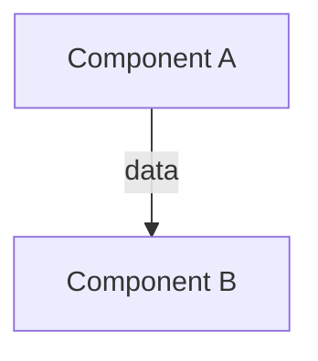

# Implementation Plan: {{TITLE}}

## Status

Proposed (awaiting Gate R2 review)

## References

- ADR: docs/00_adr/######-<title>.md

## Background & Goals

(short summary of what is being built and why)

## Components & Module Decomposition

(list of modules, classes, or services to be created or modified)

## Interfaces & Data Flows

## Risks & Open Questions

- Risk 1: mitigation
- Question 1: status

## Next Steps (One-line steps to become Change Plans)

1. Step 1 (one line per step)
2. Step 2
