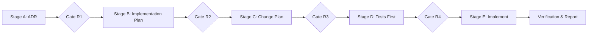

# dot-agents

A lean, modular, Anthropic Agent Skills-compliant AI governance kit for software repositories.

Optimized for:
- **Primary Harnesses:** Google Antigravity and DeepSeek Harness (`dsh`)
- **Primary Models:** Flash-tier models (`gemini-3.8-flash`, `deepseek v4.1 flash`, `glm-5.3-flash`)
- **Single Primitive:** 10 flat, unified skills discovering natively as `/` slash commands.
- **Ultra-Lean Always-On Context:** `.agents/AGENTS.md` under 50 lines with zero filler or emphasis inflation.

---

## 1. Artifact-Driven Engineering Lifecycle

All significant work follows a strict 5-stage, 4-gate workflow producing self-contained, reviewable Markdown artifacts:



| Lifecycle Stage | Trigger / Slash Command | Primary Skill | Standard Output Artifact | Review Gate |
|---|---|---|---|---|
| **Architectural Decision** | `/adr <title>` | `skills/adr` | `docs/00_adr/######-<title>.md` | Gate R1 (User Review) |
| **System Roadmap (WHAT)** | `/writing-plans` | `skills/writing-plans` | `docs/01_implementation_plans/######-<title>.md` | Gate R2 (User Review) |
| **Scoped Change Plan (HOW)** | `/writing-plans` | `skills/writing-plans` | `docs/02_change_plans/######-<title>.md` | Gate R3 (User Review) |
| **Pre-Implementation Tests** | `/writing-plans` | `skills/writing-plans` | Failing tests + `docs/03_test_plans/######-<title>.md` | Gate R4 (User Review) |
| **Trade-offs / Interview** | `/grill-me` | `skills/grill-me` | Interactive 1-question alignment | None |
| **Minimal Implementation** | `/ponytail` | `skills/ponytail` | Minimal working diffs (stdlib first) | None (Approved in R3/R4) |
| **Surgical Bug Diagnosis** | `/systematic-debugging` | `skills/systematic-debugging` | 4-phase root cause fix + circuit breaker | None |
| **Verification & Completion** | `/verification-before-completion` | `skills/verification-before-completion` | Verified test output + `...-report.md` | Informational |
| **Code & Artifact Review** | `/code-review-excellence` | `skills/code-review-excellence` | Advisory structured review | Advisory |
| **Git Commit** | `/git-commit` | `skills/git-commit` | Standardized imperative commit | User confirmation |
| **Bootstrap & Stack Scout** | `/project-init` / `/find-skills` | `skills/project-init`, `skills/find-skills` | Runtime docs (`.agents/*.md`) + stack skills | Initial setup |

---

## 2. Core Skills Roster (10 Skills)

Every skill resides in `.agents/skills/<kebab-case>/SKILL.md` with progressive disclosure (`assets/` for templates, `resources/` for checklists, `scripts/` for Python helpers):

1. **`adr`**: Record architectural decisions, trade-offs, and consequences (`scripts/adr.py`).
2. **`writing-plans`**: Author Implementation Plans, Change Plans, and Test Plans with test-first discipline.
3. **`verification-before-completion`**: Enforce fresh test evidence, call-graph reachability, and completion reports (`scripts/completion-report.py`).
4. **`code-review-excellence`**: 4-dimension reviews (correctness, security, simplicity, modularity), hunter static sweeps, and cross-model reviews (`scripts/audit-prose.py`).
5. **`git-commit`**: Standardized commit messages referencing ADRs and change plans (`scripts/commit.py`).
6. **`project-init`**: Adapt kit to target repo via `/grill-me`, scaffold runtime docs, and manage context (`scripts/update-context.py`).
7. **`find-skills`**: Discover and install stack-specific or domain-specific skills.
8. **`systematic-debugging`**: 4-phase diagnosis, minimal root-cause fixes, and oscillation circuit breaker.
9. **`ponytail`**: Minimalist implementation mode (YAGNI, standard library first, shortest working diffs).
10. **`grill-me`**: Adversarial design pressure-testing and 1-question interviews.

---

## 3. Quick Start: Install & Bootstrap

### Installation into a Target Repository

From this repository, run the installer pointing to your target project repository:

**PowerShell (Windows):**
```powershell
.\install.ps1 -TargetRepo "C:\path\to\your-project"
```

**Bash (Linux / macOS):**
```bash
./install.sh /path/to/your-project
```

The installer copies `.agents/` and root harness entry points (`AGENTS.md`, `CLAUDE.md`, `GEMINI.md`). It **never** copies `.git` and **never** overwrites existing context files (`project_overview.md`, `architecture.md`, `coding_standards.md`, `context.md`, `USER.md`) or repo-installed skills unless `-Force` / `--force` is specified.

### Bootstrap Your Project

Once installed, start an AI session in your target project and run:

```
/project-init
```

The agent will interview you via `/grill-me`, populate your project documentation, and scout stack skills matching your language and frameworks.
